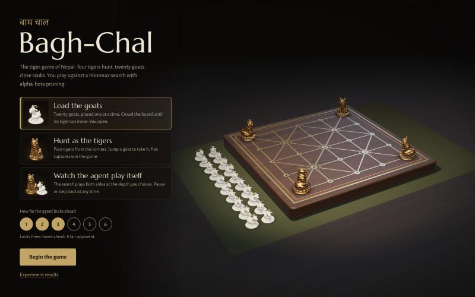
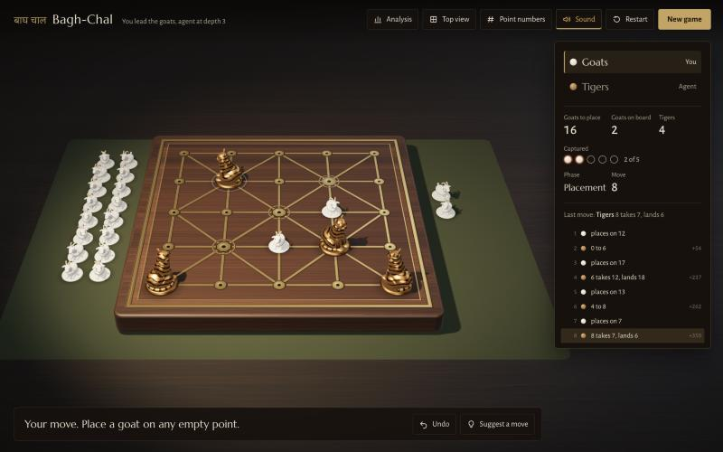
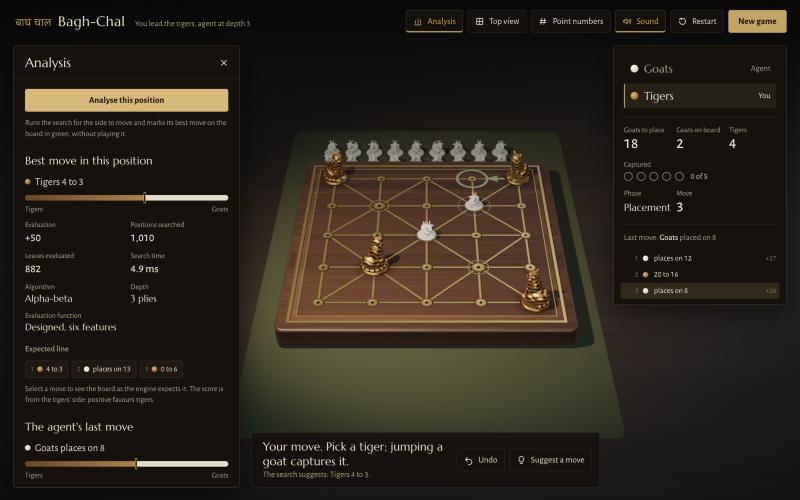

# Bagh-Chal Agent

A Bagh-Chal (tigers and goats) game-playing agent using Minimax with Alpha-Beta pruning and a designed evaluation function. BCSE306L Artificial Intelligence course project, VIT Vellore.

| Member | Reg. No. | Owns |
|---|---|---|
| Pranav Shankar | 24BCE2773 | Experiment framework, experiments, report |
| Shalom Santosh | 24BCE2731 | Minimax and alpha-beta search (owner, reviewer) |
| Vishal | 24BCE2802 | Evaluation function (owner, reviewer) |

## Status

- **Done:** rules, search, evaluation, adapter and CLI are built and tested (`python -m pytest -q`); `python -m experiments check-engine --engine baghchal.adapter:Adapter` reports 0 failures.
- **Done:** experiments E1 and E2 are run, with results, tables and plots committed in `results/`.
- **Done:** report text, slides and implementation notes in `docs/report/` and `docs/`, written by Claude Code on 2026-10-22 at Pranav's direction (PRD §10); a viva guide in `docs/viva_guide.md`.
- **Done:** experiment E3 (alpha-beta best/worst case under move ordering) with plots, the minimax vs alpha-beta comparison (`docs/algorithm_comparison.md`) and the AI/ML explanation (`docs/ai_ml_usage.md`), written by Claude Code on 2026-10-22 at Pranav's direction (PRD §10).
- **Extra:** a local 3D browser game for playing the agent (`python -m web.server`), written by Claude Code at Pranav's direction (PRD §10); it is not part of the graded core.
- **Left for the team:** the `[CHECK]` items in the report (references, contributions, the declaration's final sentence), reviewing the `[DRAFT]` paragraphs in the implementation notes, Shalom's and Vishal's code reviews (prompts 2b and 3b in `docs/prompts.md`), building the slide deck, and viva practice.

`search.py` and `evaluation.py` were written by Claude Code at Pranav's direction (see `docs/PRD.md` §10); Shalom and Vishal own and review them.

## Where to start

1. Read `docs/PRD.md` — scope, frozen game rules, interfaces, milestones.
2. `docs/prompts.md` holds the phase-by-phase prompts (Phases 0–5 are done; the review and viva prompts are next).
3. `CLAUDE.md` holds the working rules Claude Code follows in this repo.

## Setup

```bash
python3 -m venv .venv
source .venv/bin/activate
pip install -r requirements.txt
python -m pytest -q
```

## Running

All commands run from the repo root inside the venv (`source .venv/bin/activate`). Points are numbered 0–24, `index = 5*row + col`, row 0 at the top; boards use `T` tiger, `G` goat, `.` empty.

```bash
# Board with point indices and degrees
python -m baghchal rules

# Analyse any position: move, score (tiger's side), nodes, time, principal variation
python -m baghchal analyse --board "T...T/...../...../...../T...T" --to-move GOAT --in-hand 20 --captured 0 --depth 4
python -m baghchal analyse --board "TG.../GG.../..TG./...../T...T" --to-move TIGER --captured 4 --depth 3 --algorithm minimax --eval baseline

# Same, reading the five board rows from a file (one row per line; "T . . . T" spacing is fine)
python -m baghchal analyse --file pos.txt --to-move GOAT --captured 0

# Play against the agent (type 12 to place, 7-12 to move, 'moves' to list, 'quit' to stop)
python -m baghchal play --human GOAT --depth 3

# Agent against itself
python -m baghchal selfplay --depth 3 [--tiger-eval designed --goat-eval baseline]
```

`analyse` options: `--depth` (default 4), `--algorithm alphabeta|minimax` (default alphabeta), `--eval designed|baseline` (default designed). `--in-hand` defaults to 20 − goats on the board − `--captured`; `--captured` defaults to 0. Bad input prints one `error:` line and exits 1.

Experiment commands (`check-engine`, `generate`, `e1`, `e2`, `report`) are in `docs/experiments.md`; the engine spec is `baghchal.adapter:Adapter`.

Experiment E3, alpha-beta's best and worst case (the search is unchanged; `baghchal/ordering.py` only reorders moves):

```bash
python -m e3                               # 30 positions at depths 2-4 + uniform trees, ~15 s; writes results/e3_*
python -m e3 --depths 2,3 --only P01 M04   # quick trial
python -m e3 --report                      # rebuild e3 summary, tables and plots from the CSVs
```

Benchmarks (not part of the test suite):

```bash
python benchmarks/bench_rules.py     # rules hot path: calls/s against targets
python benchmarks/bench_search.py    # minimax vs alpha-beta, depths 2-4, against PRD §7 limits
```

## Play in the browser

A local 3D game (not part of the graded core, which is CLI-only per the PRD) on top of the same engine:

```bash
python -m web.server            # then open http://127.0.0.1:8765
```





**Playing.** Choose a side (or watch the agent play itself) and how far the agent looks ahead, then begin.
- Goats, placement: click any empty point. Goats, movement, and tigers: click a piece, then one of its marked points. A rust ring marks the goat a jump would capture.
- Drag to turn the table, scroll or pinch to zoom, *Top view* for a straight-down board, *Point numbers* to engrave the indices 0–24.
- *Undo* takes back your last move and the agent's reply; *Suggest a move* draws the search's choice as a green arrow. Click any move in the list to look back at that position.
- Keyboard: Tab to the board, arrow keys to walk the 25 points, Enter to click a point, Esc to deselect or leave a review.
- Unplaced goats wait beside the board and captured goats are set down on the other side, so the counts are also visible on the table.

**Analysis** (top bar) keeps everything the earlier UI had:
- The search report for the agent's last move or for *Analyse this position*: evaluation, positions searched, leaves evaluated, time, algorithm, depth, evaluation function and the expected line. Click a move of the line to see that future position on the board.
- Engine settings: alpha-beta or minimax, designed or captures-only evaluation, depth.
- *Minimax vs alpha-beta on this position*: minimax and alpha-beta in worst, rule, heuristic and best move order at depth 1–4, with a same-score check and a verdict.
- The `analyse` command for the current position, and a form to start from any typed position.
- *Experiment results* (setup screen and analysis) opens the E1 and E3 charts and tables.

**How it is built.**
- The Python engine is the only source of truth. The browser keeps the start position and the move list; `web/server.py` replays them through `baghchal.rules` and returns the position, the legal moves and the result. The front end has no rules of its own: a click becomes a move only if the engine listed it. The server and its API are unchanged by the 3D UI.
- The board's engraved lines are drawn from the engine's own R1 edge list (`GET /api/topology`), so the picture cannot disagree with the rules.
- Rendering is Three.js (WebGL), bundled with esbuild. All geometry and textures are procedural (no downloaded models or images) and the sounds are synthesised with Web Audio, so the only runtime download is two Google fonts, with system fallbacks.

| `web/frontend/src/` | Role |
|---|---|
| `api.js` | Calls to the engine |
| `game/useGame.js` | Move list, turns, agent moves, undo, review; no rules |
| `three/scene.js` | The table: lighting, picking, move animation; reconciles its pieces to the engine's position |
| `three/rig.js`, `pieces.js`, `textures.js`, `thumbs.js` | Camera, figurines, wood/brass/felt textures, setup portraits |
| `audio/sound.js` | Synthesised sounds and the sound switch |
| `ui/` | Setup, top bar, status panel, analysis, comparison, game over, flat board |

The compiled bundle `web/static/app.js` is committed, so playing needs only Python. To rebuild after editing `web/frontend/src/`:

```bash
cd web/frontend && npm install && npm run build
```

**Known limitations.**
- Without WebGL (or with `?flat` in the address) the game falls back to a flat 2D board; everything else works the same.
- Reduced-motion settings turn off the move, camera and marker animation; pieces then jump straight to their points.
- When the agent plays itself it waits for each piece to land, so a depth-1 game is paced by the animation, not the search.
- The pieces are stylised procedural figurines, not sculpted models. The front end has no automated tests; it was checked by hand in the browser (see the commit message), and the API it relies on is covered by `tests/test_web.py`.
- The bundle is about 740 kB because it includes Three.js.

## Results and report

- `results/`: E1 and E2 raw CSVs, summaries, `tables.md` and the three plots (`python -m experiments report` rebuilds them from the CSVs).
- `results/e3_*`: E3 raw CSVs, summary, `e3_tables.md` and three plots: `e3_ordering_nodes.png` (best vs worst case), `e3_ratio_d4.png`, `e3_trees.png`.
- `docs/algorithm_comparison.md`: minimax vs alpha-beta, best and worst case, and which algorithm does better when.
- `docs/ai_ml_usage.md`: how AI is used in the agent, why there is no ML, and where ML could fit.
- `docs/report/report.md`: the report (PRD §9); `docs/report/report.pdf` is the rendered version with the implementation notes and figures included.
- `docs/report/tables_appendix.md`: per-position and outcome tables; rebuild with `python tools/report_tables.py`.
- `docs/report/slides.md`: 7-slide outline with talking points.
- `docs/implementation_notes.md`: report §4.
- `docs/viva_guide.md`: answers to the viva topics in `docs/prompts.md` Phase 6.
